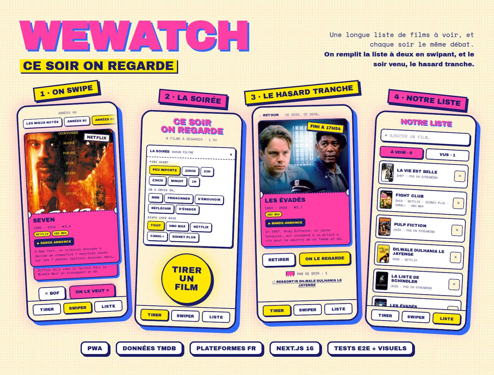
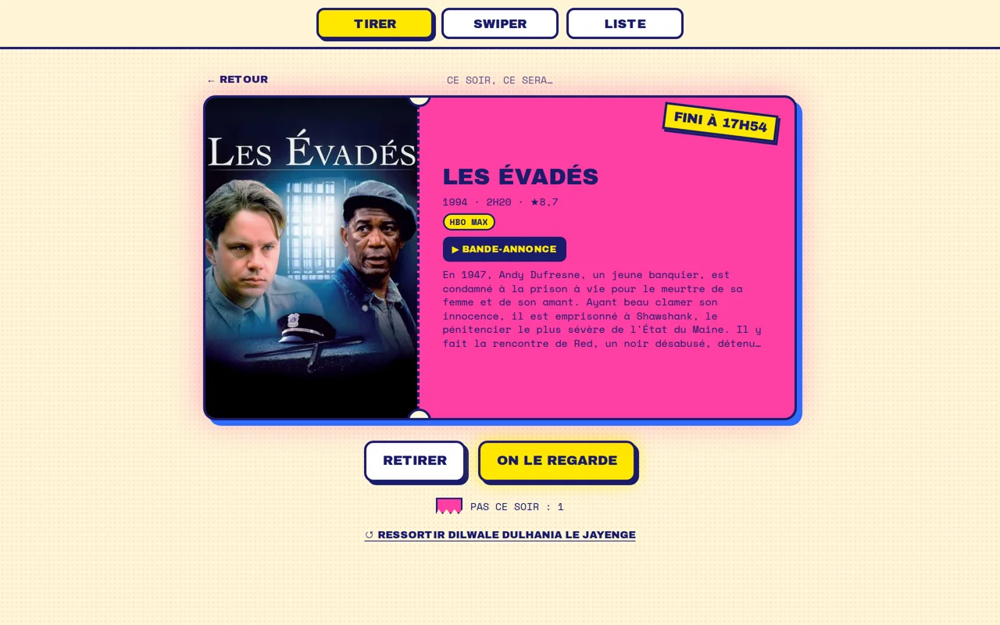
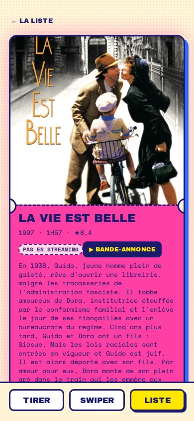

<p align="center">
  
</p>

<p align="center">
  <a href="https://github.com/thogio8/we-watch/actions/workflows/ci.yml"></a>
  <a href="https://github.com/thogio8/we-watch/releases"></a>
  
  
  <a href="LICENSE"></a>
</p>

# WeWatch

**Une longue liste de films à voir, et chaque soir le même débat.** WeWatch sépare les deux moments : on remplit la liste à deux, tranquillement, en swipant des films ; le soir venu, un bouton, un film, et c'est le hasard qui tranche.

Une petite appli web pour un couple (ou une coloc, ou une bande d'amis), installable sur l'écran d'accueil du téléphone, gratuite à héberger, en français, et volontairement joyeuse : direction artistique « ticket d'entrée », riso fluo.

## Ce qu'elle fait

**🎟️ TIRER** : le film de ce soir

- Un gros bouton, un film tiré au sort dans la liste « à voir », avec l'heure à laquelle il finira si on le lance maintenant (« FINI À 23H12 »).
- **RETIRER** déchire le ticket et en tire un autre ; les tickets déchirés s'empilent (« PAS CE SOIR ») et ne ressortent pas de la soirée, sauf si on les **↺ RESSORT**.
- **La soirée** : filtres facultatifs pour réduire le choix : heure de coucher (« FINI AVANT MINUIT »), envie du moment (RIRE, FRISSONNER, S'ÉMOUVOIR…), plateformes auxquelles on est abonnés.

**💘 SWIPER** : remplir la liste

- Des films bien notés, un par un : glisser à droite (ON LE VEUT ♥) ou à gauche (✕ BOF), ou utiliser les boutons.
- Des thèmes : les mieux notés, années 80, années 90, moins de 1h40, animation, cinéma français, cinéma coréen.
- Bande-annonce en un geste, et **↺ ANNULER** pendant quelques secondes après chaque choix.

**📋 LISTE** : notre liste

- Les films « à voir » et « vus », une recherche TMDB pour ajouter un film précis, et une fiche par film : résumé complet, genres, réalisation, têtes d'affiche, date d'ajout, actions.
- Sur chaque film, **les plateformes de streaming françaises** où il est disponible, ou « PAS EN STREAMING » : une information, jamais un filtre. C'est la liste qui compte, pas le catalogue d'une plateforme.
- Les données des films (plateformes, durées…) se rafraîchissent chaque jour.

<p align="center">
  
  &nbsp;
  
</p>

Pensée pour le téléphone, elle s'adapte à tous les écrans : petit Android, iPhone couché, tablette, grand écran (le ticket se couche comme un vrai billet).

## Essayer en local

Il faut **Node.js 24** et un jeton d'accès TMDB gratuit (themoviedb.org → Paramètres → API → « API Read Access Token »).

```bash
git clone https://github.com/thogio8/we-watch.git && cd we-watch
npm install
cp .env.example .env.local   # renseigner TMDB_ACCESS_TOKEN et BETTER_AUTH_SECRET
npm run db:migrate           # crée la base SQLite locale (local.db)
npm run dev                  # http://localhost:3000
```

Dans `.env.local` :

- `BETTER_AUTH_SECRET` : le secret des sessions, 32 caractères au moins (`openssl rand -hex 32`) ;
- `BETTER_AUTH_URL` : l'adresse de l'appli, `http://localhost:3000` en local ;
- `SIGNUP` : `open` (par défaut, tout le monde peut créer un compte) ou `invite` ;
- `OWNER_CODE` : le code propriétaire, utile seulement avec `SIGNUP=invite`.

L'appli s'ouvre sur **ENTRE DANS WEWATCH** : « CRÉER UN COMPTE », un prénom, Face ID (ou l'empreinte, ou le code de l'ordinateur), et c'est parti sur TIRER : la liste est vide, direction SWIPER.

## Héberger votre propre WeWatch

Tout tient dans les offres gratuites de **Vercel** (l'appli), **Turso** (la base SQLite) et **GitHub Actions** (tests et déploiement). Le déploiement passe uniquement par GitHub Actions : chaque push sur `main` est testé, puis la base est sauvegardée et migrée, la nouvelle version mise en ligne, vérifiée, et retirée automatiquement si la vérification échoue.

1. **Turso** : créer la base et un jeton.

   ```bash
   turso db create we-watch --location aws-eu-west-1
   turso db show we-watch --url        # → DATABASE_URL (libsql://…)
   turso db tokens create we-watch     # → DATABASE_AUTH_TOKEN
   ```

2. **Vercel** : créer le projet depuis votre copie du dépôt, sans le déployer.
   - `npx vercel link` crée le projet ; `.vercel/project.json` donne `orgId` et `projectId`.
   - Variables d'environnement **Production** : `TMDB_ACCESS_TOKEN`, `DATABASE_URL`, `DATABASE_AUTH_TOKEN`, `CRON_SECRET` et `BETTER_AUTH_SECRET` (chacun `openssl rand -hex 32`), `BETTER_AUTH_URL` (l'adresse de production, la même que `PROD_URL`), et au besoin `SIGNUP` et `OWNER_CODE` (voir « Les comptes »). Ne pas les donner aux previews : elles écriraient dans la même base.
   - `ACCESS_CODE`, l'ancien code partagé, reste dans Vercel jusqu'à la 2.1 : un retour arrière vers la 1.3.x en a encore besoin. La 2.0 l'ignore.
   - Un jeton dans Account Settings → Tokens.
   - La région des fonctions (`vercel.json`, `dub1` = Dublin) se règle au plus près de la base.
3. **GitHub** (Settings → Secrets and variables → Actions) :
   - secrets : `VERCEL_TOKEN`, `VERCEL_ORG_ID`, `VERCEL_PROJECT_ID`, `DATABASE_URL`, `DATABASE_AUTH_TOKEN`, `CRON_SECRET` ;
   - variable : `PROD_URL`, l'adresse de production (par exemple `https://votre-projet.vercel.app`).
4. **Pousser sur `main`** : la CI crée la table au premier passage, puis chaque push déploie.

## Les comptes

Chacun a son compte, et **aucun mot de passe** : le compte se crée et s'ouvre avec une passkey, c'est-à-dire Face ID, l'empreinte ou le code de l'appareil. Rien à retenir, rien à se faire voler, aucun email envoyé. Sans compte, toutes les pages mènent à **ENTRE DANS WEWATCH**.

- **Créer un compte** : un prénom ou un surnom (30 caractères au plus), puis Face ID. La passkey reste sur l'appareil, ou se synchronise avec le trousseau (iCloud, Google).
- **Revenir** : « SE CONNECTER AVEC FACE ID ». La session dure 60 jours et se prolonge toute seule tant qu'on revient ; « SE DÉCONNECTER » est en bas de LISTE.
- **Ouvert ou sur invitation** : avec `SIGNUP=open` (par défaut), n'importe qui connaissant l'adresse peut créer un compte. Avec `SIGNUP=invite`, l'écran affiche « WEWATCH SE REJOINT SUR INVITATION » et seul le **code propriétaire** (`OWNER_CODE`, 12 caractères au moins) ouvre la création : choisissez **une phrase de plusieurs mots** (« pop corn sous la couette »), longue plutôt que compliquée.
- Les passkeys sont liées à l'adresse de l'appli (`BETTER_AUTH_URL`) : changer d'adresse oblige à recréer les comptes.

> À venir : les invitations, la connexion avec Google et une page « mon compte ».

## L'installer comme une appli

C'est une PWA : une fois installée, elle s'ouvre en plein écran depuis son icône de ticket, comme une appli.

- **iPhone / iPad** (Safari) : Partager → « Sur l'écran d'accueil ».
- **Android** (Chrome) : menu ⋮ → « Installer l'application ».
- **Ordinateur** (Chrome, Edge) : icône d'installation dans la barre d'adresse.

## Sous le capot

|         |                                                                                                                                                           |
| ------- | --------------------------------------------------------------------------------------------------------------------------------------------------------- |
| Appli   | Next.js 16 (App Router, Server Actions, Cache Components), React 19, TypeScript strict                                                                    |
| Données | SQLite via Turso / libSQL, Drizzle ORM ; API TMDB appelée côté serveur uniquement                                                                         |
| Style   | CSS Modules, design tokens centralisés, animations Motion (`prefers-reduced-motion` respecté)                                                             |
| Tests   | Vitest (unitaires et fonctionnels sur une vraie base et un faux TMDB), Playwright (parcours, 6 formats d'écran, accessibilité axe, captures de référence) |
| Qualité | ESLint (taille, complexité, sens des couches), jscpd (doublons), knip (code mort)                                                                         |
| CI/CD   | lefthook en local, GitHub Actions en parallèle, versions semver automatiques (release-please)                                                             |

```
src/
  domain/    règles métier pures : films, tirage, filtres « ce soir », transitions de statut
  db/        schéma Drizzle et repository
  tmdb/      client TMDB, validation, mapping, thèmes de swipe
  auth/      comptes Better Auth : passkeys, sessions
  access/    qui entre : décision du proxy, inscription ouverte ou sur invitation
  server/    assemblage base + TMDB (un seul endroit)
  features/  un dossier par écran : composants, actions serveur, logique testée
  ui/        composants partagés sans logique métier
  app/       routes Next, manifest et icônes générées
```

La conception complète, version par version, est dans [`docs/superpowers/specs/`](docs/superpowers/specs/2026-10-23-we-watch-design.md).

## Contribuer

```bash
npm run ci          # tout ce que vérifie la CI : format, lint, types, doublons, code mort, tests, e2e
npm run test:e2e    # tests de bout en bout seuls (Docker requis)
```

Les règles du projet (architecture, conventions, définition de « fini ») sont dans [`CLAUDE.md`](CLAUDE.md), écrit pour les humains comme pour les agents de code. En bref : petits fichiers, logique pure testée, commits [Conventional Commits](https://www.conventionalcommits.org) (`feat`, `fix`… fixent le numéro de version), et la direction artistique ne se négocie pas.

## Crédits

 This product uses the TMDB API but is not endorsed or certified by TMDB. Disponibilités en streaming : [JustWatch](https://www.justwatch.com/fr), via TMDB.

## Licence

[MIT](LICENSE) : réutilisez, modifiez, hébergez, en gardant la mention de copyright. Les données de films appartiennent à TMDB et restent soumises à [leurs conditions](https://www.themoviedb.org/api-terms-of-use).
